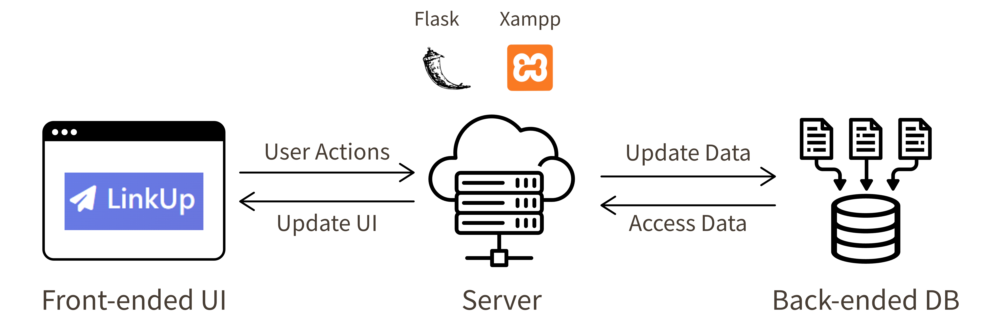
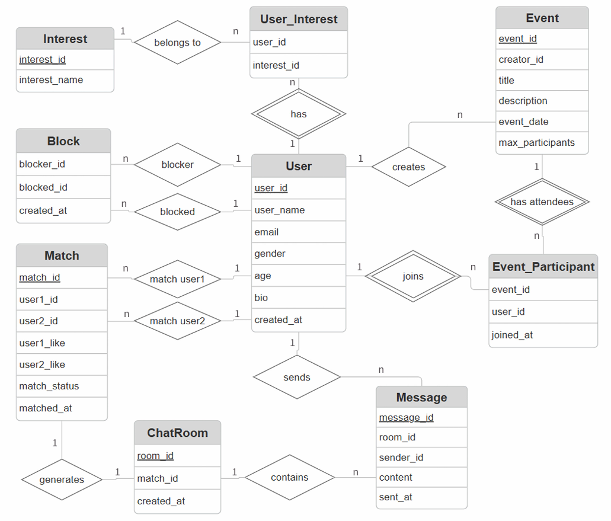

# LinkUp: Social Matching & Event Platform



A web application where users discover people with shared interests, match through mutual likes, chat, and join group events.
Course project for *Introduction to Database Systems*, Yuan Ze University (Fall 2025).

## Features

- **Discover**: browse other users and their interests; blocked users are hidden in both directions.
- **Mutual matching**: a match is formed only when both users like each other, and a chat room is created automatically.
- **Chat**: message history per matched pair.
- **Events**: list upcoming events and sign up, subject to a participant limit.
- **Blocking**: block another user to remove them from discovery.

## Database Design

Nine tables in MySQL:

| Group | Tables |
| --- | --- |
| Users | `User`, `Interest`, `User_Interest` |
| Social | `Match`, `ChatRoom`, `Message`, `Block` |
| Events | `Event`, `Event_Participant` |

Key integrity rules:

- Composite primary keys for many-to-many relations (`User_Interest`, `Block`, `Event_Participant`).
- `CHECK (user1_id < user2_id)` on `Match` stores each pair once, in a canonical order.
- `ChatRoom.match_id` is `UNIQUE`, so each match has exactly one chat room.
- Foreign keys use `ON DELETE CASCADE` to remove dependent records with their parent.



## Tech Stack

MySQL, Python, Flask, mysql-connector-python, HTML/JavaScript

## API

| Method | Endpoint | Description |
| --- | --- | --- |
| GET | `/api/users` | Users available for discovery (block-filtered) |
| POST | `/api/matches/like` | Like a user; creates a match and chat room when mutual |
| GET | `/api/my_matches` | Current user's matches |
| GET, POST | `/api/messages` | Read or send messages in a chat room |
| GET | `/api/events` | List events |
| POST | `/api/events/join` | Join an event if capacity allows |
| POST | `/api/block` | Block a user |

## Getting Started

```bash
pip install flask mysql-connector-python
cp config.example.ini config.ini     # then fill in your MySQL credentials
python init_db.py                    # creates the schema and sample data
python app.py                        # http://127.0.0.1:5000
```

## Known Limitations

- **Event capacity race condition**: the participant count is checked and the new row inserted in separate statements, so concurrent sign-ups can exceed the limit. A fix is to wrap both in a transaction with `SELECT ... FOR UPDATE`.
- **Block check on events**: blocking currently affects discovery only; event sign-up does not yet check blocks.
- **No authentication**: the current user is passed as a request parameter for demonstration purposes.

## Team

Team project (6 members) for the *Introduction to Database Systems* course at Yuan Ze University. Team member names are omitted at their request.
